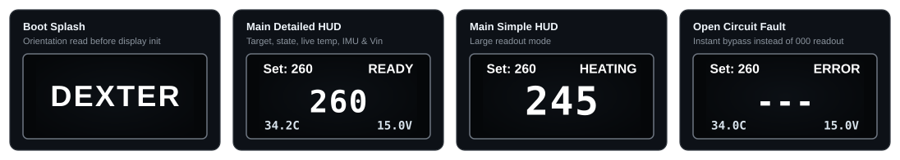
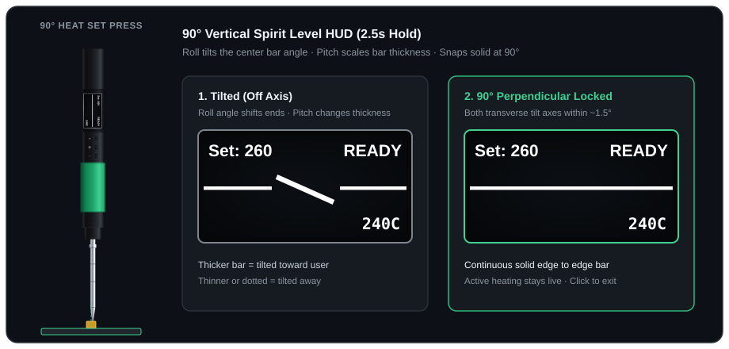

# Songguo PTS200 Firmware (v5.1.0)

The original Songguo PTS200 repository (`Eddddddddy/Songguo-PTS200`) stopped updating after `v4.5.3`, leaving flash wear, power stability, sleep/off, and sensor bugs unresolved. This standalone repository continues from `v4.5.3` with `v5.x`, resolving those hardware and firmware issues, optimizing CPU/screen responsiveness, and adding a live 90° vertical spirit level HUD for heat set inserts.

<p align="center">
  
</p>

## Display & UI Modes

<p align="center">
  
</p>

## Bugs Fixed & Improvements Over v4.5.3

### 1. EEPROM Stability & Power Regulation

* **Fixed Flash Wear Bug (`Eddddddddy` #19):** Removed EEPROM commits on every temperature knob tick. Adjusted target temperatures stay in RAM and only save to EEPROM when exiting Setup, Calibration, or tip changes.
* **EEPROM Bounds Checking & Auto Repair:** `read_EEPROM()` validates all stored limits, timers, tip counts, power profiles, and calibration order (`T200 + 10 < T280 < T360`), repairing corrupted entries automatically on boot. Fixed length `writeBytes`/`readBytes` tip name storage also prevents profile corruption.
* **Unified Power Limiting & USB PD Stability:** Consolidated output limits into `getPowerLimit()`, set PWM frequency to 200 Hz, enabled bang bang heater delivery (`PID_ENABLE = false`) with a `15V` default (`POWER_LIMIT_15 = 225`), and prevented unthrottled 100% power spikes across routines.
* **Clean USB PD Voltage Switching:** Changing voltage profiles saves to EEPROM and restarts (`ESP.restart()`) so USB PD chargers renegotiate cleanly from 5V without overvoltage or latch ups.

### 2. Temperature Sensing & Safety

* **Stopped False `ERROR` Popups Under Load:** Unified the OpAmp input filter settle window (`TIME2SETTLE = 5000` microseconds) so rapid heating does not corrupt ADC samples, and replaced truncated table segments above 360°C with continuous floating point `fmap` interpolation.
* **Adaptive Open Circuit Detection:** Uses an open circuit threshold of `280.0` below 7V USB and `470.0` on higher voltage chargers, bypassing the smoothing filter immediately on tip removal to display `---` and `ERROR` instead of `000`.
* **Fixed False `ERROR` Near Max Temperature:** Raised the display fault cutoff from `450`°C to `500`°C (`TEMP_MAX` remains `450`°C) so minor overshoot does not flash `ERROR`.
* **Accurate `isWorky` Target Tracking:** Compares tip temperature against the active sleep, boost, or normal setpoint rather than only `SetTemp`.
* **Burn Safety on Standby:** Lock mode keeps displaying live tip temperature instead of forcing `0`, and standby/lock screens display your configured `SetTemp` instead of `Set: 0`.

### 3. Sleep, Off Mode & Motion Wakeup Fixes

* **Fixed Off Mode OLED Burn In (`Eddddddddy` #8):** `SLEEPCheck()` now ignores accelerometer motion when `inOffMode` is active, preventing vibrations from waking the OLED screen permanently without a power off timer. Only a button click wakes the iron from Off mode.
* **Fixed Buzzer Self Wakeup (`Eddddddddy` #30):** Clears the motion buffer after triggers and blanks accelerometer buffering for 300 ms after piezo `beep()` chimes so entering sleep no longer shakes the LIS2DH12 awake.

### 4. Display, UI & Firmware Upgrades

* **90° Vertical Spirit Level HUD for Heat Set Inserts:** Holding the center button for 2.5 seconds switches to an alignment reticle driven by the onboard LIS2DH12 accelerometer (`LevelScreen()`) while `SENSORCheck()` and `Thermostat()` keep regulating tip heat normally in the background. Side to side roll tilts the center bar, front to back pitch adjusts bar thickness, and when held perpendicular all three segments merge into one solid horizontal bar. Single press exits back to the main screen.

<p align="center">
  
</p>

* **Non Blocking Spirit Level Activation:** Removed the blocking wait loop after the 2.5s hold trigger so temperature measurement continues updating even while keeping the button pressed.
* **Instant OLED Boot & 400 kHz I2C:** Starts the SH1107 OLED right after reading orientation from EEPROM and runs I2C at 400 kHz for low latency screen refreshes.
* **Fixed Tight Loop Re Registration in `Update FW`:** Initializes `FirmwareMSC` events and mount once before waiting for exit input.
* **Screen, CPU & Watchdog Optimizations (`v5.1.0`):**
  * Skips redundant full frame OLED I2C transfers when screen telemetry is unchanged, caps Level HUD rendering at ~30 Hz, removes duplicate `initDisplay()`, and sets explicit `u8g2.setBusClock(400000)`.
  * Rate limits LIS2DH12 chip temperature I2C reads to every 250 ms (`accelPresent` failure guarded) and adds `Wire.setTimeOut(50)` recovery.
  * Overlaps accelerometer polling and `Vin` measurement inside the 5 ms OpAmp settle window and paces `SENSORCheck()` on a steady 50 ms (`20 Hz`) cadence, while keeping sensing and heating active during the 2.5s button hold check.
  * Lowers CPU clock to `80 MHz` (keeping native USB and 80 MHz APB I2C/ADC/LEDC speeds) and sleeps idle `loop()` cycles to reduce ESP32 S2 handle heat.
  * Dims OLED contrast in sleep mode, extends auto screen off timing to manual double click Off mode, and adds a 5s `esp_task_wdt` hardware watchdog so heater MOSFET control fails safe on any stall.
* **Clean Toolchain & Libraries:** Removed unused `Button2`, eliminated manual `U8g2` font file patches, and pinned `espressif32@~6.3.2` for reproducible PlatformIO builds.

## Hardware & Controls

* **MCU:** ESP32 S2 (`ESP32-S2FH4`, 4 MB flash, native USB CDC / MSC)
* **Power & Stage:** CH224K USB PD sink + QC3.0 support, P Channel MOSFET (`AON7409`) heater control, LIS2DH12 accelerometer, 128x64 SH1107 OLED
* **Controls:**
  * **Short click (Lock mode):** Unlock and heat
  * **Short click (Active):** Toggle Boost mode (`+50`°C for `60`s)
  * **Short click (Off mode):** Wake back to active heating
  * **Double click:** Enter Off mode
  * **Hold 0.5s to 2.5s:** Open `Setup` menu
  * **Hold 2.5s+:** Open 90° Spirit Level HUD (short click to exit)
  * **Hold `+` and `-` on power up:** Reset EEPROM to defaults

## Installing Prebuilt Firmware

Download the release binaries from the Releases page and follow [docs/update_guide.md](docs/update_guide.md):

* **`PTS200_v5.1.0_update.bin`**: Use for regular upgrades via `Setup` → `Update FW` (USB MSC drag and drop).
* **`PTS200_v5.1.0_factory.bin`**: Full merged flash image starting at `0x0000` for recovery or fresh flashes.

Upgrading from stock `v4.x` updates `VERSION_NUM` to `500` and resets stored EEPROM parameters to safe defaults on first boot; upgrading within `v5.x` keeps existing settings and tip calibrations intact.

## Building From Source

### Option 1: PlatformIO (Recommended)

1. Clone this repository:

```bash
git clone https://github.com/dexterchock/Songguo-PTS200.git
cd Songguo-PTS200
```

2. Build and upload:

```bash
pio run -t upload
```

### Option 2: Arduino IDE

1. Install the **ESP32** board package (v2.0.9 / Arduino ESP32 2.x recommended).
2. Install required libraries via Library Manager:
   * `QC3Control` (`^1.4.1`)
   * `U8g2` (`^2.34.17`)
   * `ESP32AnalogRead` (`^0.2.1`)
   * `PID` (`^1.2.1`)
   * `SparkFun LIS2DH12 Arduino Library` (`^1.0.3`)
3. Board settings:
   * **Board:** `ESP32S2 Dev Module`
   * **CPU Frequency:** `80MHz` (recommended for cooler handle operation; `160MHz` or `240MHz` also supported)
   * **USB CDC On Boot:** `Enabled`
   * **Upload Mode:** `Internal USB`
4. Open and upload `SolderingPen_ESP32S2/SolderingPen_ESP32S2.ino`.

## Credits

* Original firmware by [Eddddddddy/Songguo-PTS200](https://github.com/Eddddddddy/Songguo-PTS200).
* Libraries: `QC3Control`, `U8g2`, `ESP32AnalogRead`, `PID_v1`, `SparkFun_LIS2DH12`.
